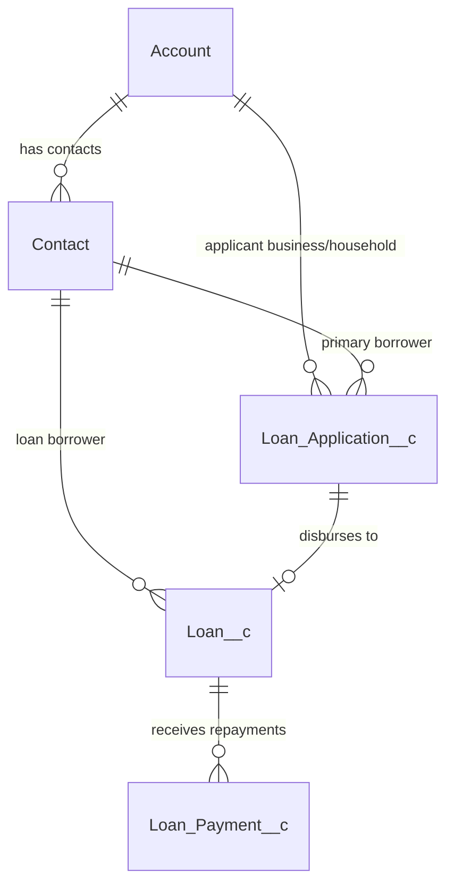

# Platypus Finance - Salesforce Loan Origination & Servicing Platform

[](https://developer.salesforce.com/)
[]()
[]()
[]()

**Platypus Finance** is an enterprise-grade Loan Origination System (LOS) and Loan Servicing platform built natively on the Salesforce Lightning Platform. It streamlines end-to-end consumer and small business lending workflows—from initial borrower intake, risk and affordability scoring, and underwriter review to multi-tranche loan disbursement, repayment processing, amortization tracking, and real-time portfolio health monitoring.

---

## 🌟 Key Capabilities & Architectural Highlights

- **Enterprise Intake & Lead-to-Borrower Pipeline**
  - Deduplication and verification of Borrowers and Co-borrowers against Account/Contact registries.
  - Real-time loan interest calculation, monthly EMI forecasting, and debt-to-income (DTI) assessment.
  - Automated routing and task assignment via Salesforce Flows and Custom Notification types.

- **Automated Underwriting & Credit Assessment**
  - Dynamic Credit Score risk band categorization (Tier 1 / Excellent, Tier 2 / Good, Tier 3 / Fair, Tier 4 / High Risk).
  - Configurable Debt-to-Income (DTI) and Loan-to-Value (LTV) guardrails with automated validation warnings.
  - Full audit trail recording underwriter approvals, conditions, rate adjustments, and rejections.

- **Strict Multi-Tranche Disbursement Controls**
  - Pre-disbursement validation requiring approved status, active bank account details, and cleared sanction conditions.
  - Auto-generation of the active `Loan__c` record, payment schedule, and disbursement receipt log upon clearance.
  - Rollup calculations ensuring disbursed funds never exceed approved sanctioned limits.

- **Loan Servicing & Cashier Operations**
  - Real-time repayment logging with automated waterfall allocation: Late Penalty Fees -> Overdue Interest -> Standard Interest -> Principal Balance.
  - Live amortization schedule recalculation and outstanding principal ledger updates.
  - Automated status progression (`Active` -> `Paid Off`, or `Delinquent` / `Defaulted` based on grace periods).

- **Executive & Operational Dashboard**
  - Single-pane view of critical business KPIs: Applications Pending Review, Total Active Portfolio Volume, Disbursed this Month, and Portfolio at Risk (PAR).
  - Actionable recent application queue with inline approvals and status transitions.

---

## 📊 Core Data Architecture



### Custom Objects

| Object API Name | Label | Description |
|---|---|---|
| `Loan_Application__c` | **Loan Application** | Captures loan request amount, term, rate, borrower details, DTI, credit score, underwriting status, and sanction notes. |
| `Loan__c` | **Loan** | Master record for an active disbursed loan, tracking principal, interest rate, term, monthly EMI, total repaid, and remaining balance. |
| `Loan_Payment__c` | **Loan Payment** | Financial transaction ledger recording repayments, cashier references, payment types (ACH, Wire, Cash), and fee splits. |

---

## ⚡ Lightning Web Components (LWC) Suite

| Component | Bundle Name | Description |
|---|---|---|
| **Executive Dashboard** | `pfLoanOfficerDashboard` | Real-time KPI summaries (Pending Reviews, Active Loans, Monthly Disbursement, PAR) + interactive applications table. |
| **New Loan Application Intake** | `pfLoanApplicationForm` | Multi-step dynamic borrower intake form with live EMI calculation and credit profile checks. |
| **Underwriter Review** | `pfLoanApplicationReview` | Credit assessment workspace with risk tier evaluation, DTI analysis, and one-click approve/reject actions. |
| **Loan Disbursement** | `pfLoanDisbursement` | Pre-disbursement audit checklist, bank verification, and immediate active loan creation. |
| **Loan Repayment & Servicing** | `pfLoanRepayment` | Cashier repayment interface with live balance lookup, payment allocation, and instant receipt generation. |

---

## 🧭 Navigation & Business Workflow Tabs

The **Platypus Finance** Lightning App organizes navigation according to the natural lifecycle of a loan:

1. ⚡ **Platypus Finance Dashboard** (`Platypus_Finance_Dashboard`)
2. 📝 **Apply for Loan** (`PF_New_Application`)
3. 🔍 **Application Review** (`PF_Application_Review`)
4. 💸 **Loan Disbursement** (`PF_Loan_Disbursement`)
5. 💳 **Loan Servicing** (`PF_Loan_Servicing`)
6. 📁 **Loan Applications** (`Loan_Application__c`)
7. 🏦 **Loans** (`Loan__c`)
8. 🧾 **Loan Payments** (`Loan_Payment__c`)
9. 👥 **Accounts & Contacts** (`standard-Account`, `standard-Contact`)
10. 📈 **Reports & Dashboards** (`standard-report`, `standard-Dashboard`)

---

## 🛡️ Security & Role-Based Permissions

Pre-configured Permission Sets manage operational governance:
- **`Platypus_Loan_Officer_Permissions`**: Granted to Loan Officers and Underwriters for full application review, credit decisioning, disbursement, and portfolio oversight.
- **`Platypus_Loan_Servicing_Officer_Permissions`**: Configured for Cashiers and Servicing Agents for payment collection, receipt issuing, and account balancing.

---

## 🧪 Testing & Code Quality Metrics

The platform includes a comprehensive, isolated Apex test suite adhering to Salesforce enterprise testing standards:
- **Test Results**: **103 Passed / 0 Failed (100% Pass Rate)**
- **Org-Wide Apex Coverage**: **91%** (well above Salesforce's 75% deployment threshold)
- **Key Test Classes**:
  - `LoanApplicationServiceTest` (Intake, validation rules, risk scoring)
  - `LoanServiceTest` (Disbursement logic, balance updates, status transitions)
  - `LoanPaymentServiceTest` (Waterfall payment allocation, overpayment safeguards)
  - `PFLoanOfficerDashboardControllerTest` (Dashboard query caching and metric calculations)
  - `LoanApplicationTriggerTest`, `LoanTriggerTest`, `LoanPaymentTriggerTest` (Trigger execution safety & bulk handling)

---

## 🚀 Deployment & Local Development

### 1. Prerequisites
- [Salesforce CLI](https://developer.salesforce.com/tools/salesforcecli) (`sf` CLI v2.x+)
- Developer or Enterprise Edition Salesforce Org
- VS Code with [Salesforce Extension Pack](https://marketplace.visualstudio.com/items?itemName=salesforce.salesforcedx-vscode)

### 2. Clone the Repository
```bash
git clone https://github.com/Dhanush11D/PlatypusFinance.git
cd PlatypusFinance
```

### 3. Authorize Org
```bash
sf org login web --set-default --alias PlatypusDev
```

### 4. Deploy Source to Org
```bash
sf project deploy start --target-org PlatypusDev
```

### 5. Assign Permissions
```bash
sf org assign permset --name Platypus_Loan_Officer_Permissions --target-org PlatypusDev
```

### 6. Run Test Suite
```bash
sf apex run test --test-level RunLocalTests --code-coverage --result-format human --target-org PlatypusDev
```

---

## 📄 License
This project is proprietary and confidential. Developed for the Platypus Finance Loan Origination and Servicing ecosystem.
